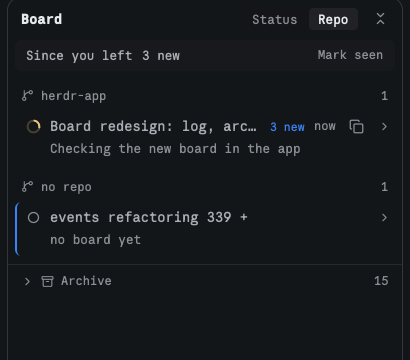

# Board

A catch-up panel for Herdr: one row per open tab saying what its agent is doing, what it decided and what it needs from you, so you can come back after hours away and know where every task stands in a few seconds. Agents write to it with a small command; the panel reads those files and draws them.

## What you see

Top to bottom, in a 360px-wide panel with no background of its own (the layout's block paints it):

- **Header, 38px:** "Board" (12.5px semibold), a Status | Repo switch (11.5px, the chosen side on `theme().raised`), and a collapse-all icon button (24px).
- **Since you left, 28px pill** on `theme().surface`: "Since you left", then "N blocked" in `blocked`, "N done" in `done`, "N new" lines, and Mark seen on the right. Hidden when there is nothing new.
- **Groups.** Status view: Needs you (blocked or done), In progress (working), Idle. Repo view: one group per repo with a git-branch icon, the most urgent repo first and "no repo" last. Each group label is 11px `dim` with a count on the right. Empty groups are not drawn.
- **Rows, 28px**, rounded 6, in Herdr's tab order inside each group: status icon, title (the board's goal, else the tab name), "N new" in `accent`, age, a copy-folder icon button, and a chevron. A folded row shows one 11.5px line under the title: the blocker, else the current step, else the goal, else "asked: <last prompt>".
- **Open card** on `theme().surface`: a `now` / `blocked` / `done` line, a `next` line, the last 5 trail lines (› your prompt in `accent`, ✓ step in `done`, ◆ decision in `foreground`, unseen lines bright with a 5px `accent` dot), "+ N earlier", and a footer with the folder path and Copy context.
- **The tab you're on** has a 2px `accent` left border.
- **Archive** at the bottom: boards whose tab is closed, folded behind a chevron and archive icon with a count; each row has Reopen (a new tab in that folder), copy folder and age.

## How it behaves

- **Status icons:** working is Herdr's spinner ring (`mods/workspace-chrome/spinner.svg`, spinning 900ms) in `working`; done is circle-check in `done`; blocked is circle-alert in `blocked`; idle is a hollow circle in `dim`.
- Clicking a row opens or folds it. At most 3 cards are open; opening a 4th folds the one opened longest ago. Before you fold anything, cards that need you start open. Collapse all folds everything.
- Copy folder writes the board's `root` to the clipboard and shows ✓ for 1.2 s. Copy context writes the goal, folder, current step, blockers, the last 8 log lines and next steps as plain text for a new agent.
- Mark seen sets the "last looked" time; log lines after it count as new. On first load everything already there counts as seen.
- The view, open cards and last-seen time are kept per panel in `localStorage`.
- Boards reload when the board folder changes (`watchFolder`), and every 10 s as a fallback.

## Built from

- **Trail:** every prompt (stamped by the hooks) joins the log as `kind: "prompt"` (› in `accent`), and changing `now` logs the previous step as `kind: "step"`, so the trail grows without the agent remembering to log. Prompts never count as new.
- **Data:** one JSON file per tab in `~/.config/herdr-app/board/<tab id>.json`: `{ version, tab, root, project, goal, now, next[], blockers[], links[], log[{at, kind: "step" | "decision", text}], last_prompt, updated, by }`.
- **Writer:** `herdr/scripts/board.mjs` in this repo (install it as `~/.config/herdr/scripts/board.mjs`). `board.mjs set --goal --now --next --blocker --clear-blockers --log --decision` from inside a Herdr tab; it finds the tab from the terminal's `herdr.tab` label (`hc get $HC_TERMINAL_ID --json`) and writes atomically. `board.mjs stamp --prompt` records the last prompt; the `hooks/board-stamp.sh` UserPromptSubmit hook calls it.
- **Agent instructions:** `skills/board/SKILL.md` says when to write and when to log.
- **Mod files:** `board.js` holds every rule (grouping, folded line, done, the 3-open limit, copied context) and is tested with plain `node --test tests/`; `main.js` only draws. Icons: Herdr's `workspace-chrome` set plus `copy.svg`, `circle-alert.svg`, `circle.svg`, `collapse.svg` from Lucide.
- **herdr API:** `spaces()`, `focused()`, `theme()`, `props()`, `home()`, `readTextFile`, `watchFolder`, `run("tab.new")`, `cx.write_to_clipboard`.
- **Layout block** (example, beside the tab block):
  `{ "id": "board", "type": "block", "content": { "mod": "board" }, "size": { "px": 360 }, "background": "background", "border": { "width": 1, "color": "#33363b" }, "radius": 12 }`. Use your panes' own border color so it matches them.

## Watch out

- GPUI elements here have no `rotate()`: swap `chevron-right.svg` / `chevron-down.svg` instead. `herdr-app check` won't catch it, because it renders with no tabs.
- "Here" must come from `focused().tab`: `tab.active` is true for one tab in every space.
- The prompt hook updates `updated` on every prompt, so "updated" alone is not news; only new log lines and newly blocked or done tasks count.
- Run through a symlink, `board.mjs` must compare real paths in its main-module check, or it silently does nothing.
- `board.mjs` imports `scripts/project-context.mjs` from this repo to find the git root; copy it too, or replace it with `git rev-parse --show-toplevel`.
- A tab's repo and folder come from its agent's live folder (`panes()` `cwd`, run through `git rev-parse --show-toplevel` once per folder), so tabs whose agent never writes a board still group by repo. A board's own `project`/`root` win.
- Herdr doesn't hot-reload a mod folder that is a symlink: after editing through one, restart the copy (switch layouts and back).
- Needs Node and `jq` (the hook).

## Done when

- `herdr-app check mods/board` passes and `node --test tests/` passes.
- `board.mjs set --goal "x" --log "y"` in a Herdr tab makes that tab's row show "x", and opening it shows "y".
- A blocked tab moves to Needs you and the Since you left pill counts it.
- Opening a 4th card folds the oldest; Collapse all folds all.
- Closing a tab with a board moves it into Archive; Reopen starts a tab in its folder.
- The tab you're on, and only it, has the accent left border.
