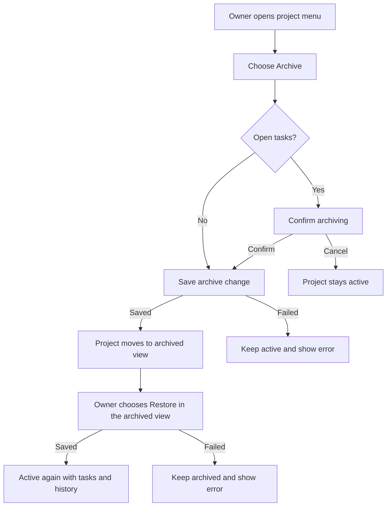

# GitHub issue calibration example

A reader should know what changes, why it matters, and how to verify it without opening the parent issue. See the [issue format](../../references/workflow.md#issue-format).

## Weak issue

```markdown
# Add project archiving

- Add an `archived` database column.
- Create archive and unarchive endpoints.
- Change the project-list query.
- Add an Archive button.
- Add tests.
```

It is a task list. It names a schema and endpoints, says nothing about who needs this or why, and gives no way to tell when it is done.

## Strong issue

````markdown
# Archive and restore projects

Parent: #40

## Change
Let project owners move finished projects from the active list to an archived view. From that view, owners can restore a project to the active list with its tasks and history intact.

## Why
Finished projects stay in the active list, making current projects harder to find. Deleting a finished project clears the list but removes its tasks and history from reference.

## Flowchart


## Done when
- [ ] Given an owner on the project list, when they archive a project, then it disappears from the active list and appears in the archived view
- [ ] Given a project with open tasks, when the owner archives it, then confirmation is required; cancelling leaves it active
- [ ] Given an owner in the archived view, when they restore a project, then it reappears in the active list with its tasks and history intact
- [ ] Given a viewer without owner rights, when they try to archive or restore a project, then the action is unavailable and attempts are rejected
- [ ] Given a save failure, when the owner archives or restores, then the project stays in its previous state and an error is shown
- [ ] Given keyboard-only navigation, when the owner archives or restores a project, then all controls and confirmation are operable and the result is announced accessibly

## Out of scope
Bulk archiving (#44), automatic archiving after inactivity
````

It names one change, shows its path and failures, and gives one acceptance checklist. The parent owns the broader design; Project fields own priority and size, and issue relationships own blockers. The technical plan, written when this issue is taken, references the checklist and explains the code changes and tests without copying the issue.
