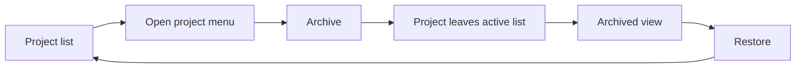

# Ticket Calibration Example

How a slice becomes a ticket that says what and why, never how. Read `~/.agents/references/workflow.md` for the full format.

## Weak ticket

```markdown
# Add project archiving

- Add an `archived` database column.
- Create archive and unarchive endpoints.
- Change the project-list query.
- Add an Archive button.
- Add tests.
```

It is a task list. It names a schema and endpoints, says nothing about who needs this or why, and gives no way to tell when it is done.

## Strong ticket

````markdown
# Archive and restore projects

Parent: #40 · Priority: Should (cluttered lists slow down daily work) · Size: S · Blocked by: —

## User story
As a project owner, I want to archive finished projects so that my active list shows only current work.

## Context
Finished projects stay in the main list forever. Owners scroll past dozens of
old projects, and some delete projects they still need for reference.

## User flow


## Edge cases
- Archiving a project with open tasks → asks for confirmation first
- A viewer without owner rights → no Archive option
- Restoring → project returns with its tasks and history unchanged

## Acceptance criteria
- [ ] Given an owner on the project list, when they archive a project, then it disappears from the active list
- [ ] Given an archived project, when the owner opens the archived view, then it is listed there
- [ ] Given an archived project, when the owner restores it, then it reappears in the active list with its tasks intact
- [ ] Given a viewer without owner rights, when they open the project menu, then Archive is not offered

## Out of scope
Bulk archiving (#44), automatic archiving after inactivity

## Done when
Tests pass · reviewed · keyboard accessible
````

It explains the problem and the user, shows the path and its failures, and gives checks anyone can run, while leaving every technical choice to the implementation plan written when the ticket is taken.
